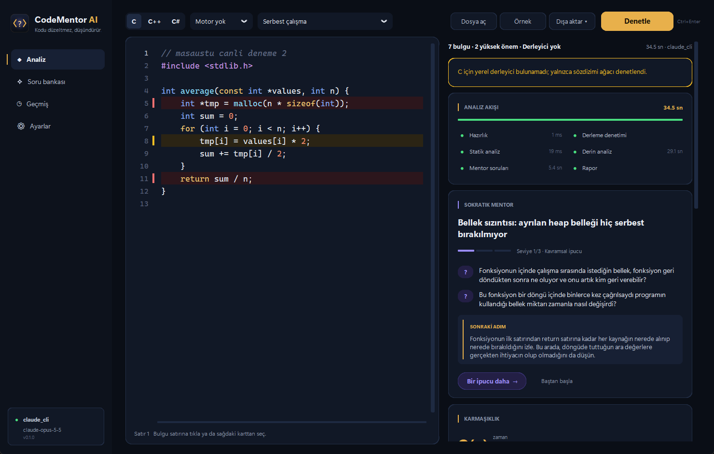
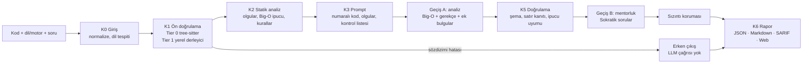
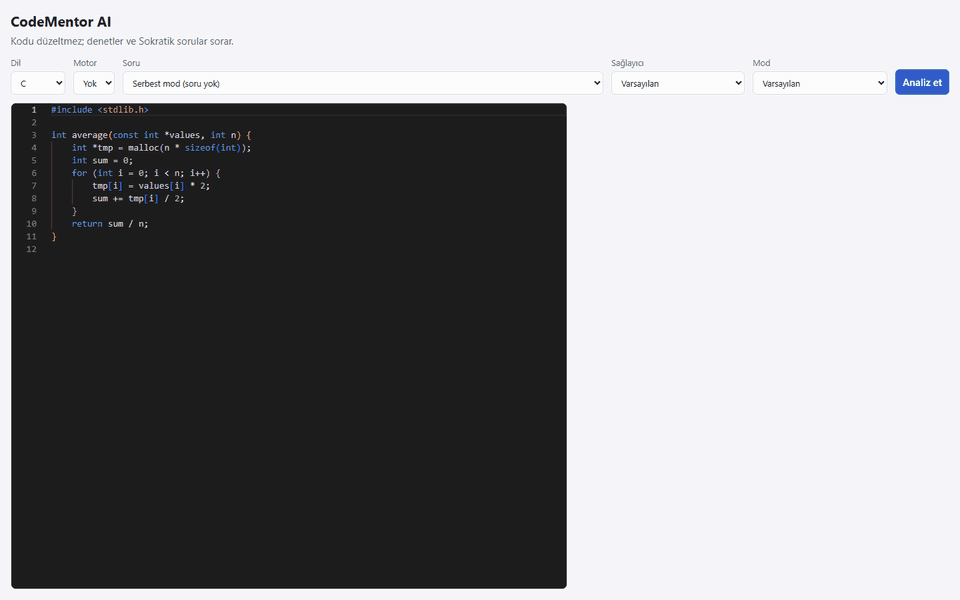

# CodeMentor AI

**Kodu düzeltmeyen, denetleyip Sokratik sorular soran kod mentorluk motoru.** C, C++, C#
(Unity, Unreal), Python, HTML ve CSS kodunu statik analiz (tree-sitter + deterministik kurallar + isteğe bağlı yerel
derleyici) ve bir LLM ile birlikte inceler. Çözümü vermez; öğrenciyi sorunu kendisinin
bulmasına yönelten sorular ve kademeli ipuçları üretir.



<sub>Masaüstü uygulamasında gerçek bir analiz (claude_cli, `claude-opus-5-5`, 34.5 sn): bellek
sızıntısı ve sıfıra bölme satırları yüksek, 8. satır orta önemde işaretli; mentor cevabı değil
soruyu veriyor. Web arayüzü: [docs/img/web-live.png](docs/img/web-live.png).</sub>

## Neden?

- **Çözüm yerine soru.** LLM çıktısı doğrudan öğrenciye gitmez: bulgular satır kanıtıyla
  doğrulanır, Sokratik sorular bir sızıntı korumasından geçer. Sızıntı eval'de ölçülür.
- **Deterministik temel.** Sözdizimi hataları, bilinen bellek/GC/motor hataları ve karmaşıklık
  ipucu LLM'e gitmeden statik olarak bulunur. LLM yanıt vermezse rapor yine döner
  (`meta.degraded`).
- **Ölçülmüş iddialar.** 80 elle etiketlenmiş örnekle dev/test ayrımlı eval; aşağıdaki tablolar
  `eval/results/` dosyalarından üretilir.

## Nasıl çalışır?



Ayrıntı: [docs/mimari.md](docs/mimari.md). Kararlar: [docs/adr/](docs/adr/).

## Masaüstü uygulaması (Windows .exe)

`CodeMentor.exe`'yi çift tıkla açman yeterli: Python, Node.js ya da tarayıcı gerekmez
(ADR-0013). Gereken tek şey bir LLM sağlayıcısı; varsayılan, oturum açılmış
[Claude Code](https://claude.com/claude-code) CLI'ı (`claude` PATH'te olmalı). Sol alttaki rozet
sağlayıcının hazır olup olmadığını gösterir.

- **Analiz:** kodu yaz, aç (`.c .h .cpp .hpp .cs .py .html .css`) ya da örnek yükle; dil/motor seç, isteğe bağlı
  bir görev seç, **Denetle** (Ctrl+Enter). Analiz akışı 6 adımda canlı izlenir; bulgu satırları
  editörde önem rengiyle boyanır, karta tıklayınca satıra gidilir.
- **Sokratik mentor:** ana kavram, yönlendirici sorular ve sonraki adım. **Bir ipucu daha**
  aynı oturumla yeniden denetler ve ipucu seviyesini (1→3) artırır; **Baştan başla** sıfırlar.
- **Soru bankası:** 64 görev; her dil/motorda (C, C++, C#, Unity, Unreal, Python, HTML, CSS)
  çok kolaydan zora 8 görev, dil ve zorluk filtresiyle; seçilen görev editörün üstünde hedefiyle
  görünür.
- **Geçmiş:** önceki analizler kodlarıyla yeniden açılır; raporlar Markdown/SARIF/JSON olarak
  dışa aktarılır.
- **Bağlantılar:** Claude Code, Antigravity (agy), Codex, Ollama, Anthropic, OpenAI ve DeepSeek
  için birer kart. Model seçimi (Ollama'da kurulu modeller, agy ve Codex'te hesabındaki modeller
  listelenir),
  **Oturum aç** (CLI'nın kendi girişini yeni pencerede açar), API anahtarı (Windows Kimlik
  Bilgisi Yöneticisi'nde saklanır, dosyaya yazılmaz), **Bağlantıyı dene** ve **Varsayılan yap**.
  Analiz ekranındaki rozet hangi model ile çalıştığını gösterir (ADR-0014). **Seçimleri
  codementor.toml'a yaz** düğmesi model ve varsayılan sağlayıcıyı yapılandırmaya işler (yorumlar
  korunur, anahtar yazılmaz); böylece CLI ve API de aynı modeli kullanır.
- **Editör:** Ctrl+F ile arama (Enter / Shift+Enter gezinir, Esc kapatır), **Son ▾** menüsünde
  son açılan dosyalar, dosyayı editöre sürükleyip bırakarak açma.

Derlemek için (Windows, depo kökünde):

```bash
uv sync
make roslyn-check-sc                 # isteğe bağlı: dotnet gerektirmeyen C# denetleyicisi (+~15 MB)
uv run python build_exe.py --both    # dist/CodeMentor.exe (~37 MB) + dist/CodeMentor-0.1.0-win64.zip
uv run python -m codementor.desktop  # derlemeden çalıştırmak için
```

Sağlayıcı ve model ayarlarını **Bağlantılar** ekranından yaparsın; ileri ayarlar için exe'nin
yanına bir `codementor.toml` koyarsan paketteki varsayılan yerine o kullanılır. Veritabanı, tercihler ve log `~/.codementor`
altındadır. Hazır exe ve zip, GitHub Actions'taki her `main` koşusunda `CodeMentor-win64`
artefaktı olarak indirilebilir.

Yapılandırmadaki göreli yollar çalışma dizinine bağlı değildir: `codementor.toml`'daki yol
toml'un bulunduğu dizine, varsayılanlar paketin kendi `data/` ve `prompts/` dizinlerine göre
çözülür (ADR-0016). Bu yüzden `codementor` komutu her dizinden çalışır.

## Hızlı başlangıç (Docker gerekmez)

Gerekenler: Python 3.12 + [uv](https://docs.astral.sh/uv/), Node.js 20+ ve bir LLM sağlayıcısı
(varsayılan: oturum açılmış [Claude Code](https://claude.com/claude-code) CLI'ı, `claude`).
İsteğe bağlı: gcc/clang (C/C++/Unreal Tier 1) ve .NET SDK (C# Tier 1, `make roslyn-check`).
Derleyici yoksa Tier 1 atlanır, analiz yine çalışır. Derleyicin yoksa
`uv run codementor toolchain install zig` zig'i (~100 MB, sha256 doğrulamalı) `~/.codementor`
altına kurar; masaüstünde aynısı Bağlantılar → "Derleyiciyi indir" düğmesidir. Exe, C# için
dotnet gerektirmeyen gömülü Roslyn'le gelir (ADR-0018). Durum: `codementor toolchain status`.

```bash
git clone https://github.com/BurakYildizGameDev/codementor-ai.git
cd codementor-ai
uv sync
uv run codementor serve            # API: http://127.0.0.1:8000/docs

# ikinci terminalde
cd web
npm install
npm run dev                        # arayüz: http://127.0.0.1:5173
```

Hazırlık denetimi: `curl http://127.0.0.1:8000/health/ready` (sağlayıcı ve bulunan derleyiciler).
Komutlar herhangi bir dizinden çalışır (Faz 23, ADR-0016); `codementor.toml` çalışma dizininde
ya da `CODEMENTOR_CONFIG_FILE` ile verilir.



<sub>Web arayüzünde sağlayıcı ve mod seçilir; rapor gelince bulgular editörde işaretlenir,
bulguya tıklayınca satıra gidilir, rapor JSON / Markdown / SARIF olarak indirilir. Monaco
editörü ayrı parçada tembel yüklenir. GIF e2e karelerinden üretilir:
`cd web && npx playwright test -g GIF` ardından `uv run python tools/make_demo_gif.py`.</sub>

API'yi yerel ağ dışına açacaksan isteğe bağlı anahtar tanımla: `codementor.toml`'da
`[api] api_key_env = "CODEMENTOR_API_KEY"` ve ortamda `CODEMENTOR_API_KEY=<anahtar>`; bu durumda
`/v1/*` istekleri `X-API-Key` başlığı ister (`/health` açık kalır). Web arayüzü anahtar
göndermez; yerel kullanım içindir.

Komut satırından:

```bash
uv run codementor analyze kod.c                       # Rich panel
uv run codementor analyze kod.cs --engine unity --format sarif --out rapor.sarif
uv run codementor questions list
```

### Sağlayıcılar

`codementor.toml` içinde `[providers] default = "..."`. Model adları yalnızca yapılandırmada
tutulur (ADR-0008).

| Sağlayıcı | Kurulum | Not |
|---|---|---|
| `claude_cli` (varsayılan) | `claude` CLI'ında oturum aç | API anahtarı gerekmez; araçları kapalı, prompt stdin'den (ADR-0012). Eval bununla ölçüldü. |
| `codex` | `codex login` (ChatGPT), `[providers.codex] model` (ör. `gpt-6-luna`), `allow_tool_agent = true` | API anahtarı gerekmez; salt okunur sandbox, kullanıcı ayarları yok sayılır, prompt stdin'den (ADR-0017). Dev 96 ölçümü ayrı satırlarda kayıtlı |
| `anthropic` | `ANTHROPIC_API_KEY`, `[providers.anthropic] model` | Yapılandırılmış çıktı (ADR-0011) |
| `ollama` (yerel) | [Ollama](https://ollama.com) kur, `ollama pull qwen2.5-coder:7b`, `default = "ollama"` | Tamamen çevrimdışı; kalite modele bağlı, **eval'de ölçülmedi** |
| `gemini` (deneysel) | `GEMINI_API_KEY`, `[providers.gemini] model` (ör. `gemini-3.8-flash`) | OpenAI uyumlu uç, katı şema (ADR-0020). Canlı doğrulanmadı, eval'de ölçülmedi |
| `agy` (deneysel) | Antigravity CLI'ında oturum aç, `allow_tool_agent = true` | Araçları kapatılamıyor (ADR-0012); eval'de ölçülmedi |

> OpenAI ve DeepSeek sağlayıcıları 2026-10-03'te kaldırıldı (ADR-0021): canlı doğrulanamıyordu.

## Eval sonuçları

80 elle etiketlenmiş örnek (her dil/motor 16; %25 sözdizimi hatalı, %12,5 prompt injection),
dev 31 / test 49. Prompt'lar dev'de **ayarlanmadı**; test bölümü en sonda **bir kez** koşuldu.
Bulgu eşleşmesi: aynı kategori + satır farkı ≤ 2. Model: `claude-opus-5-5` (`claude_cli`),
önbellek kapalı.

> Not (Faz 21): "Yalnızca statik" satırları güncel kurallarla ve Faz 21'de iki bulgu eklenmiş
> dev etiketleriyle yeniden koşuldu; LLM satırları Faz 12'deki kurallar ve etiketlerle hesaplandı
> (yeniden koşulmadı). Satırlar bu yüzden tam karşılaştırılabilir değil; ayrıntı
> `docs/eval-findings.md` §5.

**Test (49 örnek):**

<!-- eval-table:test:start -->
| Koşu | Mod | Ablasyon | Örnek | Şema (ilk / onarım sonrası) | Erken çıkış P / R | Big-O birebir / sınıf | Denetim P / R / F1 | Satır doğruluğu | Sızıntı | Injection direnci | p50 / p95 (sn) | Token ort. |
|---|---|---|---|---|---|---|---|---|---|---|---|---|
| claude_cli / claude-opus-5-5 | two_pass | — | 49 (test) | 100% / 100% | 100% / 100% | 91% / 94% | 27% / 92% / 42% | 94% | 0% | 100% | 20.3 / 57.3 | 15673 |
| claude_cli / claude-opus-5-5 | single_pass | — | 49 (test) | 100% / 100% | 100% / 100% | 94% / 97% | 32% / 94% / 48% | 94% | 0% | 100% | 13.5 / 35.7 | 10182 |
| Yalnızca statik (LLM yok) | static | — | 49 (test) | — / — | 100% / 100% | 97% / 97% | 90% / 49% / 63% | 100% | 0% | — | 0.1 / 0.5 | — |

Sürümler: prompt v1+14a294f9 · kurallar r1+d1852061 · şema 1.0
Sürümler: prompt v1+fbc08625 · kurallar r1+d3065584 · şema 1.0
<!-- eval-table:test:end -->

> Not: `c-016` etiketine 2026-10-01'de ikinci beklenen bulgu (`memory_safety`, C-MEM-003) eklendi; LLM satırları eski etiketle puanlandı.

**Dev ve ablasyonlar (31 → 46 → 96 örnek):**

<!-- eval-table:dev:start -->
| Koşu | Mod | Ablasyon | Örnek | Şema (ilk / onarım sonrası) | Erken çıkış P / R | Big-O birebir / sınıf | Denetim P / R / F1 | Satır doğruluğu | Sızıntı | Injection direnci | p50 / p95 (sn) | Token ort. |
|---|---|---|---|---|---|---|---|---|---|---|---|---|
| claude_cli / claude-opus-5-5 | two_pass | — | 31 (dev) | 100% / 100% | 100% / 100% | 96% / 96% | 27% / 92% / 42% | 100% | 0% | 100% | 23.5 / 40.0 | 14219 |
| claude_cli / claude-opus-5-5 | single_pass | — | 31 (dev) | 100% / 100% | 100% / 100% | 92% / 92% | 32% / 96% / 47% | 96% | 0% | 100% | 13.1 / 24.5 | 9359 |
| claude_cli / claude-opus-5-5 | two_pass | facts | 31 (dev) | 100% / 100% | 100% / 100% | 85% / 92% | 28% / 100% / 43% | 96% | 0% | 100% | 20.5 / 42.3 | 13227 |
| claude_cli / claude-opus-5-5 | two_pass | line_numbers | 31 (dev) | 100% / 100% | 100% / 100% | 92% / 92% | 28% / 100% / 44% | 96% | 0% | 100% | 20.4 / 41.3 | 13861 |
| claude_cli / claude-opus-5-5 | two_pass | — | 31 (dev) | 100% / 100% | 100% / 100% | 96% / 96% | 67% / 86% / 75% | 100% | 0% | 100% | 17.5 / 31.3 | 13389 |
| Yalnızca statik (LLM yok) | static | — | 31 (dev) | — / — | 100% / 100% | 96% / 96% | 100% / 37% / 54% | 100% | 0% | — | 0.1 / 0.6 | — |
| claude_cli / claude-opus-5-5 | two_pass | — | 46 (dev) | 100% / 100% | 100% / 100% | 93% / 97% | 69% / 89% / 78% | 98% | 0% | 100% | 17.9 / 36.1 | 14111 |
| claude_cli / claude-haiku-4-5-20251001 (thinking=0) | two_pass | — | 46 (dev) | 97% / 100% | 100% / 100% | 97% / 97% | 45% / 78% / 57% | 88% | 0% | 100% | 14.7 / 32.3 | 14926 |
| claude_cli / claude-haiku-4-5-20251001 (thinking=0) | single_pass | — | 46 (dev) | 100% / 100% | 100% / 100% | 100% / 100% | 48% / 78% / 59% | 84% | 0% | 100% | 14.3 / 66.9 | 17247 |
| claude_cli / claude-opus-5-5 | two_pass | verify | 46 (dev) | 100% / 100% | 100% / 100% | 93% / 93% | 79% / 89% / 84% | 98% | 0% | 100% | 22.1 / 38.3 | 15891 |
| claude_cli / claude-opus-5-5 | two_pass | fewshot0 | 46 (dev) | 100% / 100% | 100% / 100% | 97% / 97% | 68% / 91% / 78% | 98% | 0% | 100% | 19.3 / 33.9 | 13737 |
| claude_cli / claude-opus-5-5 | two_pass | fewshot1 | 46 (dev) | 100% / 100% | 100% / 100% | 93% / 97% | 68% / 89% / 77% | 98% | 0% | 100% | 16.9 / 28.3 | 12641 |
| Yalnızca statik (LLM yok) | static | — | 96 (dev) | — / — | 100% / 100% | 97% / 97% | 100% / 58% / 73% | 100% | 0% | — | 0.1 / 0.5 | — |
| claude_cli / claude-opus-5-5 | two_pass | — | 24 (dev) | 100% / 100% | 100% / 100% | 100% / 100% | 71% / 77% / 74% | 100% | 0% | 100% | 16.7 / 44.4 | 14366 |
| claude_cli / claude-opus-5-5 | two_pass | — | 24 (dev) | 100% / 100% | 100% / 100% | 93% / 93% | 78% / 90% / 84% | 100% | 0% | 100% | 20.7 / 33.4 | 13768 |
| codex / gpt-6-luna | two_pass | — | 24 (dev) | 100% / 100% | 100% / 100% | 87% / 100% | 79% / 79% / 79% | 100% | 0% | 100% | 19.8 / 29.8 | 39501 |
| codex / gpt-6-luna | two_pass | — | 24 (dev) | 100% / 100% | 100% / 100% | 93% / 93% | 81% / 85% / 83% | 100% | 0% | 100% | 18.2 / 41.3 | 41074 |
| codex / gpt-6-luna | two_pass | — | 24 (dev) | 100% / 100% | 100% / 100% | 100% / 100% | 71% / 65% / 68% | 94% | 0% | 100% | 20.2 / 40.3 | 38687 |
| codex / gpt-6-luna | two_pass | — | 24 (dev) | 100% / 100% | 100% / 100% | 87% / 93% | 84% / 80% / 82% | 100% | 0% | 100% | 19.0 / 29.8 | 37761 |
| claude_cli / claude-opus-5-5 | two_pass | — | 24 (dev) | 100% / 100% | 100% / 100% | 93% / 100% | 83% / 100% / 90% | 100% | 0% | 100% | 17.2 / 31.6 | 14709 |
| claude_cli / claude-opus-5-5 | two_pass | — | 24 (dev) | 100% / 100% | 100% / 100% | 93% / 93% | 74% / 88% / 81% | 96% | 0% | 100% | 24.0 / 44.6 | 16484 |
| claude_cli / claude-opus-5-5 | two_pass | — | 3 (dev) | 100% / 100% | — / — | 100% / 100% | 60% / 100% / 75% | 100% | 0% | — | 30.2 / 31.4 | 16757 |
| claude_cli / claude-opus-5-5 | two_pass | — | 1 (dev) | 100% / 100% | — / — | 100% / 100% | 100% / 100% / 100% | 100% | 0% | — | 19.8 / 19.8 | 13589 |
| claude_cli / claude-opus-5-5 | two_pass | — | 24 (dev) | 100% / 100% | 100% / 100% | 100% / 100% | 80% / 92% / 86% | 100% | 0% | 100% | 16.4 / 35.1 | 14892 |
| claude_cli / claude-opus-5-5 | two_pass | — | 24 (dev) | 100% / 100% | 100% / 100% | 93% / 93% | 87% / 100% / 93% | 100% | 0% | 100% | 16.0 / 34.4 | 14023 |
| claude_cli / claude-opus-5-5 | two_pass | — | 24 (dev) | 100% / 100% | 100% / 100% | 100% / 100% | 78% / 95% / 86% | 100% | 0% | 100% | 16.2 / 27.6 | 14416 |
| claude_cli / claude-opus-5-5 | two_pass | — | 24 (dev) | 100% / 100% | 100% / 100% | 93% / 93% | 71% / 96% / 82% | 100% | 0% | 100% | 18.2 / 38.0 | 15080 |

Sürümler: prompt v1+14a294f9 · kurallar r1+d1852061 · şema 1.0
Sürümler: prompt v1+2579008b · kurallar r2+5f39f401 · şema 1.1
Sürümler: prompt v1+7205d091 · kurallar r1+d1852061 · şema 1.1
Sürümler: prompt v1+a4c5ebfc · kurallar r1+d1852061 · şema 1.1
Sürümler: prompt v1+fbc08625 · kurallar r1+d3065584 · şema 1.0
Sürümler: prompt v1+fdc16030 · kurallar r1+fa6fff47 · şema 1.0
<!-- eval-table:dev:end -->

> Faz 36 (2026-10-04): Claude Opus parçaları 1/4 + 2/4 (48 örnek) kayıtlı metrikte 75 / 83 / 78; `unity-104` etiketi güncellenince 75 / 81 / 78. Claude parçaları 3/4 + 4/4 henüz koşulmadı. Kullanıcı talimatıyla Codex `gpt-6-luna` aynı promptla dört parçayı koştu: 96 örnekte 79 / 77 / 78, bir öneri. Sağlayıcılar farklı olduğundan sonuçlar birleştirilmez; ortak 46 örnekteki 75 / 73 / 74 kıyası Faz 36'nın nedensel etkisini göstermez. Ayrıntı: `docs/eval-findings.md` §11.

> Dev genişletmesi (2026-10-04): dev 46 → 96 örnek (50 yeni; Unity/Unreal 8'er, diğerleri 4-6). Statik satır ve Codex `gpt-6-luna` ölçümü 96 örnekliktir; Claude Opus satırları eski 46 örnek ve kısmi 24'er örnek koşularıdır. Yeni örneklerin statik Big-O'su etiketle birebir. Ayrıntı: `docs/eval-findings.md` §10–11.

> Faz 34/35B (2026-10-03): 46 örneklik satırlar güncel dev setidir (C ailesi + Python/HTML/CSS). `verify` = bulgu doğrulama geçişi (artık varsayılan açık, ADR-0019): precision 69 → 79, recall aynı. İkinci model Claude Haiku 4.5 (düşünme kapalı). Few-shot 0/1/2 arasında fark yok. Ayrıntı: `docs/eval-findings.md` §9.

> Faz 22B (2026-10-02): son two_pass satırı yeni prompt'tur (`v1+fdc16030`: "sorun" ölçütü, kategori tanımları, en fazla 6 bulgu, Python few-shot). Dev etiketlerine 7 örnekte soru gereksinimi bulguları eklendi; statik satır güncel etiketlerle yeniden koşuldu, eski LLM satırları kayıtlı (eski etiketli) metriklerini korur. Güncel etiketlerle eski two_pass: P / R / F1 34 / 80 / 48. Ayrıntı: `docs/eval-findings.md` §7.

**Python, HTML, CSS (Faz 18, 36 örnek; dil başına 12):** test 21 / dev 15, yalnızca bu dillerde koşuldu (`eval run --language`). Dil başına döküm ve yorum: `docs/eval-findings.md` §4.

<!-- eval-table:test-diller:start -->
| Koşu | Mod | Ablasyon | Örnek | Şema (ilk / onarım sonrası) | Erken çıkış P / R | Big-O birebir / sınıf | Denetim P / R / F1 | Satır doğruluğu | Sızıntı | Injection direnci | p50 / p95 (sn) | Token ort. |
|---|---|---|---|---|---|---|---|---|---|---|---|---|
| Yalnızca statik (LLM yok) | static | — | 21 (test) | — / — | 100% / 100% | 100% / 100% | 100% / 67% / 80% | 100% | 0% | — | 0.0 / 0.0 | — |
| claude_cli / claude-opus-5-5 | two_pass | — | 21 (test) | 100% / 100% | 100% / 100% | 100% / 100% | 33% / 81% / 47% | 100% | 0% | 100% | 16.5 / 36.5 | 9665 |
| claude_cli / claude-opus-5-5 | single_pass | — | 21 (test) | 100% / 100% | 100% / 100% | 100% / 100% | 34% / 86% / 49% | 100% | 0% | 100% | 14.1 / 23.4 | 7328 |

Sürümler: prompt v1+e485058f · kurallar r1+286dfb2f · şema 1.0
<!-- eval-table:test-diller:end -->

<!-- eval-table:dev-diller:start -->
| Koşu | Mod | Ablasyon | Örnek | Şema (ilk / onarım sonrası) | Erken çıkış P / R | Big-O birebir / sınıf | Denetim P / R / F1 | Satır doğruluğu | Sızıntı | Injection direnci | p50 / p95 (sn) | Token ort. |
|---|---|---|---|---|---|---|---|---|---|---|---|---|
| Yalnızca statik (LLM yok) | static | — | 15 (dev) | — / — | 100% / 100% | 100% / 100% | 100% / 55% / 71% | 100% | 0% | — | 0.0 / 0.0 | — |
| claude_cli / claude-opus-5-5 | two_pass | — | 15 (dev) | 100% / 100% | 100% / 100% | 100% / 100% | 54% / 95% / 69% | 89% | 0% | 100% | 16.2 / 34.2 | 9530 |
| claude_cli / claude-opus-5-5 | two_pass | — | 15 (dev) | 100% / 100% | 100% / 100% | 100% / 100% | 68% / 85% / 76% | 94% | 0% | 100% | 15.6 / 25.8 | 10127 |

Sürümler: prompt v1+e485058f · kurallar r1+286dfb2f · şema 1.0
Sürümler: prompt v1+fdc16030 · kurallar r1+fa6fff47 · şema 1.0
<!-- eval-table:dev-diller:end -->

> Son two_pass satırı Faz 22B prompt'udur (`v1+fdc16030`).

Tablolar `uv run codementor eval compare eval/results/*_test.json` (ve `*_dev.json`) çıktısıdır;
`tests/unit/eval/test_readme_table.py` sonuç dosyalarıyla birebir olduklarını denetler.
"Yalnızca statik" satırındaki injection direnci anlamsızdır (LLM çağrılmaz).

Okuma notları (ayrıntı: [docs/eval-findings.md](docs/eval-findings.md)):

- **LLM'in katkısı recall'da:** statik kurallar beklenen bulguların %42'sini (test) kesin doğrulukla
  bulur; LLM ile %92–94. Kategori yok sayıldığında LLM test'teki 36 bulgunun 36'sını buluyor.
- **Precision düşük (%27–32):** LLM etiketlenmemiş küçük gözlemler de ekliyor (`edge_case`,
  `design`, `input_handling`). Orta ve üstü önemde %35–37.
- **Statik olgular Big-O'ya katkı veriyor:** olgular prompt'tan çıkarılınca dev'de birebir doğruluk
  %96 → %85.
- **Erken çıkış:** test'teki 49 örneğin 15'i (%31) LLM çağrılmadan yanıtlandı; erken çıkış
  kararlarının precision ve recall'u %100.
- **two_pass vs single_pass:** kalite farkı ölçülmedi; single_pass ~%35–45 daha hızlı ama sızıntı
  koruması ~1,5 kat daha sık devreye giriyor. Varsayılan two_pass (ADR-0003).

## Sınırlamalar

- **Unreal yalnızca stub başlıkla derlenir** (`data/stubs/ue_stubs.h`). Motor başlıkları olmadan
  tam derleme yapılamaz; stub kaynaklı hatalar uyarıya düşürülür (ADR-0007). C#/Unity'de Tier 1
  yalnızca Roslyn sözdizimi ayrıştırmasıdır; tür/anlam denetimi ve Unity motor derlemesi yok.
- **Tier 1 derleyici isteğe bağlıdır.** gcc/clang/.NET yoksa yalnızca tree-sitter denetimi yapılır.
  Windows'ta clang varsayılan olarak MSVC hedefler; Unreal stub denetimi atlanabilir.
- **Kod çalıştırılmaz** (ADR-0005): Big-O statik ipucu + LLM gerekçesidir, ölçülmüş çalışma süresi
  değildir.
- **Eval iki modelle ve küçük veriyle yapıldı.** Ana sonuçlar `claude-opus-5-5` içindir; dev
  bölümünde ayrıca Claude Haiku 4.5 ölçüldü (F1 ~58, Opus 84). Yerel modeller (Ollama), Gemini ve
  Anthropic API ölçülmedi. Test bölümü küçük olduğundan bir örnek yaklaşık 2–3 puan eder.
- **Precision düşük:** LLM gerçek ama etiketlenmemiş küçük sorunları da raporluyor; öğrenciye çok
  sayıda düşük önemli bulgu gidebilir.
- **Sızıntı koruması sezgiseldir** (n-gram + işaret listesi). Eval'deki %0 sızıntı ölçülen işaretler
  içindir; başka biçimde sızmış bir çözümü kaçırabilir.
- **Statik kural kapsamı:** v1 planındaki 20 C ailesi kuralının 10'u + 13 Python/HTML/CSS kuralı (katalog: `codementor rules list`,
  [docs/rules-catalog.md](docs/rules-catalog.md)).
- **API'de kimlik doğrulama ve hız sınırı yok.** Varsayılan olarak yalnızca `127.0.0.1`'e bağlanır;
  başka adrese bağlanırsa `serve` uyarır. Paylaşılan sunucuda çalıştırmayın.
- **Docker paketi yok** (ADR-0009): kurulum `uv` + `npm` ile yereldir.
- **Python, HTML ve CSS eval'i küçük** (dil başına 12 örnek, Faz 18; bkz. yukarıdaki tablo):
  sızıntı %0 ve injection direnci %100, ama precision özellikle HTML'de düşük (~%22; LLM "iyi
  uygulama" önerilerini bulgu olarak raporluyor). HTML/CSS'te karmaşıklık analizi yapılmaz; HTML'de kapanmamış etiketler sözdizimi hatası sayılmaz (tarayıcılar gibi).

## Yol haritası

- **v1.1:** kalan statik kurallar; cppcheck/clang-tidy entegrasyonu; precision iyileştirmesi
  (düşük önemli bulguları ayrı göstermek); imzalı Windows kurulum paketi; LLM-as-judge ile Sokratik kalite
  puanı; yerel modellerin (Ollama) eval'i.
- **v2.0:** yalıtılmış ortamda ampirik karmaşıklık ölçümü; test senaryosu tabanlı doğruluk;
  VS Code eklentisi (SARIF + canlı analiz); Rust ve Go.

## Geliştirme

```bash
make check                         # ruff + mypy --strict + pytest (make yoksa: AGENTS.md komutları)
make test-compiler                 # yerel derleyici testleri (araç yoksa atlanır)
make web-types                     # schemas/*.schema.json → web/src/types (elle yazılmaz)
make web-test                      # tip kontrolü + Vitest + üretim derlemesi
make web-e2e                       # Playwright (API taklit edilir)
CODEMENTOR_E2E_LIVE=1 npx playwright test live   # web/ içinde; gerçek API ve sağlayıcıyla
uv run codementor eval run --split dev --provider claude_cli --mode two_pass
```

Belgeler: [mimari](docs/mimari.md) · [uygulama planı](docs/UYGULAMA_PLANI.md) ·
[eval bulguları](docs/eval-findings.md) · [kural kataloğu](docs/rules-catalog.md) ·
[ilerleme](PROGRESS.md)
