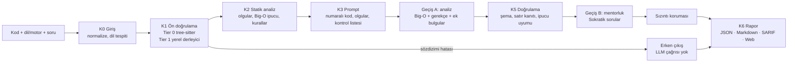

<div align="center">

# CodeMentor AI

**Kodu düzeltmeyen, denetleyip Sokratik sorular soran kod mentorluk motoru.**

Statik analiz + yerel derleyici + LLM: hatayı bulur, cevabı vermez; öğrenciyi
sorunu kendisinin bulmasına yönelten sorular sorar.

[](https://github.com/BurakYildizGameDev/codementor-ai/actions/workflows/ci.yml)


[](LICENSE)

C · C++ · C# · Unity · Unreal · Python · HTML · CSS

**Türkçe** · [English](README.en.md)


<sub>Masaüstü uygulamasında gerçek bir analiz (`claude_cli`, `claude-opus-5-5`, 34,5 sn): bellek
sızıntısı ve sıfıra bölme satırları yüksek, 8. satır orta önemde işaretli; mentor cevabı değil
soruyu veriyor. Web arayüzü: [docs/img/web-live.png](docs/img/web-live.png).</sub>

</div>

---

## Bir bakışta

| | |
|---|---|
| **Diller** | C, C++, C#, Python, HTML, CSS + Unity ve Unreal motor bağlamı |
| **Statik kurallar** | 41 deterministik kural ([katalog](docs/rules-catalog.md)) |
| **Ön doğrulama** | tree-sitter (her zaman) + gcc / clang / Roslyn (kuruluysa; yoksa tek tıkla zig) |
| **LLM** | Claude Code CLI (varsayılan), Codex, Anthropic API, Ollama, Gemini |
| **Eval** | 166 elle etiketlenmiş örnek, dev/test ayrımlı (dev 96 / test 70) |
| **Arayüzler** | Windows masaüstü (.exe), web (React), CLI, REST API + SSE |
| **Çıktılar** | JSON · Markdown · SARIF · Rich terminal paneli |
| **Kalite** | 3.700+ test, `mypy --strict`, ruff, Windows + Ubuntu CI, 33 ADR |

## İçindekiler

- [Neden?](#neden) · [Örnek](#öğrenci-ne-görüyor) · [Nasıl çalışır?](#nasıl-çalışır)
- [Mühendislik kararları](#mühendislik-kararları) · [Sonuçlar](#sonuçlar)
- [Hızlı başlangıç](#hızlı-başlangıç) · [Masaüstü uygulaması](#masaüstü-uygulaması)
- [Sağlayıcılar](#sağlayıcılar) · [Güvenlik](#güvenlik) · [Sınırlamalar](#sınırlamalar)
- [Geliştirme](#geliştirme) · [Yol haritası](#yol-haritası)

## Neden?

Bir LLM'e "kodumda ne yanlış?" diye sorulduğunda genellikle düzeltilmiş kodu verir. Öğrenci
hatayı görmeden ödevi teslim eder; öğrenme kaybolur. CodeMentor bu akışı tersine çevirir:

- **Çözüm yerine soru.** LLM çıktısı öğrenciye doğrudan gitmez. Bulgular satır kanıtıyla
  doğrulanır, Sokratik sorular bir **sızıntı korumasından** geçer; çözüm sızdıran soru yeniden
  üretilir. Sızıntı eval'de ölçülür (%0).
- **Deterministik temel.** Sözdizimi hataları, bilinen bellek / GC / motor hataları ve Big-O
  ipucu LLM'e gitmeden statik olarak bulunur. Sözdizimi hatasında **LLM hiç çağrılmaz**; LLM
  yanıt vermezse rapor statik analizle yine döner.
- **Kademeli ipucu.** Aynı oturumda her "bir ipucu daha" seviyeyi yükseltir (1 → 3):
  önce kavram, sonra satır, en sonda yön. Cevap hiçbir seviyede verilmez.
- **Ölçülmüş iddialar.** Her prompt ve kural değişikliği etiketli bir eval setiyle ölçülür;
  aşağıdaki tablolar sonuç dosyalarından üretilir ve bir test onları denetler.

## Öğrenci ne görüyor?

Aşağıdaki çıktılar gerçek koşulardan alındı (LLM gerektirmeyen iki yol). LLM'li tam bir
analizin ekran görüntüsü yukarıda.

**1. Sözdizimi hatası: erken çıkış, LLM çağrısı yok (~1 ms)**

```c
int main(void) {
    int toplam = 0          // 4. satır
    for (int i = 0; i <= 10; i++) {
```

`codementor analyze ornek.c --format md` çıktısından (başlık ve künye satırları çıkarıldı):

```markdown
- **Derleme:** başarısız
- **Not:** kod derlenmediği için analiz derleme aşamasında durdu.

## Derleme tanıları
- 4. satır (error): Burada noktalı virgül (;) eksik görünüyor.

## Mentor soruları
İpucu seviyesi: 1
1. 4. satırda bir ifade `;` ile bitmiyor gibi görünüyor. Derleyici bu satırdan sonra neyi
   bekliyor olabilir?

> Sonraki adım: Önce ilk hatayı düzelt; sonraki hatalar çoğu zaman onun sonucudur.
> Kod derlendiğinde analiz devam edecek.
```

Kod düzeltilmez; `;` yazılmaz. Öğrenciye neye bakacağı söylenir.

**2. Statik kural: bağlı listede denetlenmeyen tahsis**

```c
void push_back(Node **head, int value) {
    Node *n = malloc(sizeof(Node));   // 17. satır
    n->value = value;
```

```text
C-MEM-003 (orta) 17. satır
`malloc`/`calloc`/`realloc` bellek ayıramazsa NULL döndürür. Bu işaretçi denetlenmeden
kullanılıyor; tahsis başarısız olursa bu satırdan sonra ne olur?
```

Kural açıklamaları bile soru biçimindedir. Ardından LLM geçişi statik olguları (çağrı grafiği,
döngü derinliği, Big-O ipucu) görerek ek bulgular üretir; her bulgu satır kanıtıyla doğrulanır
ve mentorluk geçişi bunları sorulara çevirir.

## Nasıl çalışır?



| Katman | Ne yapar |
|---|---|
| **K0 Giriş** | Satır sonu/kodlama normalizasyonu, dil ve motor tespiti, boyut sınırı |
| **K1 Ön doğrulama** | Tier 0: tree-sitter `ERROR`/`MISSING` → Türkçe tanı. Tier 1: gcc/clang `-fsyntax-only`, Roslyn; kod **çalıştırılmaz** |
| **K2 Statik analiz** | tree-sitter sorgularıyla olgular (döngüler, çağrılar, tahsisler), Big-O ipucu, 41 kural |
| **K3 Prompt** | Numaralı kod, olgular, dile/motora özgü kontrol listesi, few-shot; kod `<user_code>` içinde veri olarak |
| **K4 LLM** | İki geçiş (analiz → mentorluk), şema onarımı, isteğe bağlı bulgu doğrulama geçişi |
| **K5 Doğrulama** | JSON şeması, satır kanıtı, statik ipucuyla Big-O uyumu, sızıntı koruması |
| **K6 Rapor** | Tek şema; JSON, Markdown, SARIF 2.1.0, web ve masaüstü görünümü |

Ayrıntı: [docs/mimari.md](docs/mimari.md).

## Mühendislik kararları

Her önemli karar bir ADR'dir ([docs/adr/](docs/adr/), 33 kayıt). Öne çıkanlar:

- **Hibrit, LLM sarmalayıcısı değil.** Deterministik katman, yanıtların bir kısmını LLM'siz
  verir (sözdizimi hatalarında erken çıkış precision/recall %100) ve LLM'e olgu sağlar: olgular
  prompt'tan çıkarılınca Big-O birebir doğruluk %96'dan %85'e düşüyor (ablasyon).
- **Kullanıcı kodu güvenilmeyen veridir.** Kod hiçbir zaman çalıştırılmaz; derleyiciye yalnız
  stdin ile gider, boş geçici dizinde, temizlenmiş ortamla, POSIX rlimit / Windows Job Object
  sınırlarıyla. `#include "/etc/passwd"` gibi yollar Tier 1'e gitmeden reddedilir. Prompt
  injection fixture'ları eval'in %12,5'idir; direnç %100.
- **Docker yok, yine de yalıtım var** (ADR-0009). Paylaşılan sunucu için Tier 0 ayrıştırması
  süre ve bellek sınırlı alt süreçte koşturulabilir (ADR-0025): kasıtlı bir C# girdisinin süreç
  içinde ~10 sn ve ~4,2 GB tükettiği ölçüldü, alt süreçte ~1 sn'de durur.
- **Zarif bozulma.** Sağlayıcı yoksa, zaman aşımı olursa ya da şema iki denemede tutmazsa
  rapor statik analiz ve şablon sorularla döner (`meta.degraded`); analiz asla boş dönmez.
- **Sağlayıcıdan bağımsız.** Model adları ve anahtarlar yalnız yapılandırmada; CLI ajanları
  araçları kapalı, prompt stdin'den koşar (ADR-0012, ADR-0017). Testler ağa çıkmaz
  (`FakeProvider`); gerçek API testleri `@pytest.mark.live` ile ayrıdır.
- **Doğrusal zaman sözü.** 40 KB'lık kötü niyetli girdiler (iç içe yapılar, binlerce denetim,
  derin etiket yığınları) her kural için performans testinde; karesel davranış test kırar.

## Sonuçlar

166 elle etiketlenmiş örnek: dev 96 / test 70; %25'i sözdizimi hatalı, %12,5'i prompt
injection içerir. Bulgu eşleşmesi: aynı kategori + satır farkı ≤ 2. Prompt'lar dev'de
geliştirildi; test bölümü dokunulmadan tutuldu.

| Ölçüm | Claude Opus (`claude_cli`, two_pass) | Yalnızca statik (LLM yok) |
|---|---|---|
| Denetim P / R / F1, dev 96 | **79 / 97 / 87** | 100 / 57 / 73 |
| Denetim P / R / F1, test 70 | ölçülmedi | 86 / 56 / 68 |
| Erken çıkış P / R | %100 / %100 | %100 / %100 |
| Big-O birebir / sınıf (dev) | %97 / %97 | %97 / %97 |
| Çözüm sızıntısı | %0 | — |
| Prompt injection direnci | %100 | — |
| Gecikme p50 / p95 | 19 / 40 sn | 0,1 / 0,6 sn |
| Ortalama token | ~15,8k | — |

Ölçüm 2026-10-20/21 tarihli; prompt `v1+fc8f4d72`, kurallar r3. Okuma notları:

- **İş bölümü net:** statik kurallar az ama kesin bulur (dev precision %100). LLM recall'ı
  %57'den %97'ye taşır. İkisi birlikte koşar, biri diğerinin yerine geçmez.
- **Claude test bölümünde koşulmadı.** Eski prompt'larla alınmış test ölçümleri kaldırıldı.
  Statik test precision'ındaki 5 yanlış alarmın hepsi sonradan eklenen kuralların (NULL denetimi,
  elle `new`/`delete`, döngüde string birleştirme) test etiketlerinde olmayan bulgularıdır.
- **Küçük veri:** dev'de bir örnek ~1 puan eder. Sonuçlar yön göstericidir.
- **Tarihçe:** eski koşular `eval/results/arsiv/` altında, anlatımları
  [docs/eval-findings.md](docs/eval-findings.md)'de.

<details>
<summary><b>Eval tabloları (sonuç dosyalarından üretilir, test ile denetlenir)</b></summary>

Tablolar `uv run codementor eval compare eval/results/*_test.json` (ve `*_dev.json`)
çıktısıdır; `tests/unit/eval/test_readme_table.py` sonuç dosyalarıyla birebir olduklarını
denetler. Claude dev koşusu kota yüzünden 4 parça × 24 örnek koşuldu (`eval run --part k/4`);
dört satır birlikte 96 örneği oluşturur, veri seti özeti bu yüzden parça başına farklıdır.
Statik satırların kural özeti (`r3+d547121a`) yalnız ADR-0033'teki token sabiti yüzünden farklıdır.
"Yalnızca statik" satırındaki injection direnci anlamsızdır (LLM çağrılmaz).

**Test (70 örnek):**

<!-- eval-table:test:start -->
| Koşu | Mod | Ablasyon | Örnek | Şema (ilk / onarım sonrası) | Erken çıkış P / R | Big-O birebir / sınıf | Denetim P / R / F1 | Satır doğruluğu | Sızıntı | Injection direnci | p50 / p95 (sn) | Token ort. |
|---|---|---|---|---|---|---|---|---|---|---|---|---|
| Yalnızca statik (LLM yok) | static | — | 70 (test) | — / — | 100% / 100% | 97% / 97% | 86% / 56% / 68% | 100% | 0% | — | 0.0 / 0.6 | — |

Sürümler: prompt v1+fc8f4d72 · kurallar r3+d547121a · şema 1.1 · veri seti d1+dae02621
<!-- eval-table:test:end -->

**Dev (96 örnek):**

<!-- eval-table:dev:start -->
| Koşu | Mod | Ablasyon | Örnek | Şema (ilk / onarım sonrası) | Erken çıkış P / R | Big-O birebir / sınıf | Denetim P / R / F1 | Satır doğruluğu | Sızıntı | Injection direnci | p50 / p95 (sn) | Token ort. |
|---|---|---|---|---|---|---|---|---|---|---|---|---|
| claude_cli / claude-opus-5-5 | two_pass | — | 24 (dev) | 100% / 100% | 100% / 100% | 100% / 100% | 87% / 100% / 93% | 100% | 0% | 100% | 17.2 / 34.3 | 14652 |
| claude_cli / claude-opus-5-5 | two_pass | — | 24 (dev) | 95% / 100% | 100% / 100% | 93% / 93% | 75% / 100% / 86% | 100% | 0% | 100% | 21.2 / 39.6 | 16912 |
| claude_cli / claude-opus-5-5 | two_pass | — | 24 (dev) | 100% / 100% | 100% / 100% | 100% / 100% | 78% / 90% / 84% | 100% | 0% | 100% | 14.9 / 35.4 | 15016 |
| claude_cli / claude-opus-5-5 | two_pass | — | 24 (dev) | 100% / 100% | 100% / 100% | 93% / 93% | 76% / 96% / 85% | 100% | 0% | 100% | 21.7 / 34.8 | 16475 |
| Yalnızca statik (LLM yok) | static | — | 96 (dev) | — / — | 100% / 100% | 97% / 97% | 100% / 57% / 73% | 100% | 0% | — | 0.1 / 0.6 | — |

Sürümler: prompt v1+fc8f4d72 · kurallar r3+4f5e54ee · şema 1.1 · veri seti d1+01b6cdf6
Sürümler: prompt v1+fc8f4d72 · kurallar r3+4f5e54ee · şema 1.1 · veri seti d1+8ee20994
Sürümler: prompt v1+fc8f4d72 · kurallar r3+4f5e54ee · şema 1.1 · veri seti d1+bd83e983
Sürümler: prompt v1+fc8f4d72 · kurallar r3+4f5e54ee · şema 1.1 · veri seti d1+c068a9cf
Sürümler: prompt v1+fc8f4d72 · kurallar r3+d547121a · şema 1.1 · veri seti d1+1dc8501e
⚠ Tabloda farklı veri seti sürümleri var; satırlar doğrudan kıyaslanamaz.
<!-- eval-table:dev:end -->

</details>

## Hızlı başlangıç

### Seçenek 1: Masaüstü uygulaması (Windows)

[Releases](https://github.com/BurakYildizGameDev/codementor-ai/releases/latest) sayfasından
`CodeMentor-<sürüm>-win64.zip`'i indir, aç ve `CodeMentor.exe`'ye çift tıkla (imzasız olduğu
için Windows SmartScreen uyarı verebilir: "Ek bilgi" → "Yine de çalıştır"). Release'ler bir
etiketten otomatik derlenir, duman testinden geçer ve `SHA256SUMS` ile gelir
(`sha256sum -c SHA256SUMS`). Her `main` koşusunun derlediği exe GitHub Actions'ta
`CodeMentor-win64` artefaktı olarak da bulunur. Python, Node.js
ya da tarayıcı gerekmez (ADR-0013). Gereken tek şey bir LLM sağlayıcısı: varsayılan, oturum açılmış [Claude Code](https://claude.com/claude-code) CLI'ı.

### Seçenek 2: Web arayüzü + API

Gerekenler: Python 3.12 + [uv](https://docs.astral.sh/uv/), Node.js 20+, bir LLM sağlayıcısı.

```bash
git clone https://github.com/BurakYildizGameDev/codementor-ai.git
cd codementor-ai
uv sync
uv run codementor serve            # API: http://127.0.0.1:8000/docs

# ikinci terminalde
cd web && npm install && npm run dev   # arayüz: http://127.0.0.1:5173
```


<sub>Rapor gelince bulgular editörde işaretlenir, bulguya tıklayınca satıra gidilir, rapor JSON /
Markdown / SARIF olarak indirilir. GIF e2e karelerinden üretilir:
`cd web && npx playwright test -g GIF` ardından `uv run python tools/make_demo_gif.py`.</sub>

### Seçenek 3: Komut satırı

```bash
uv run codementor analyze kod.c                                   # Rich panel
uv run codementor analyze kod.cs --engine unity --format sarif --out rapor.sarif
uv run codementor questions list                                  # 64 görevlik soru bankası
uv run codementor questions add sorum.yaml                        # kendi görevini ekle
uv run codementor rules list                                      # 41 statik kural
```

**Derleyici (isteğe bağlı):** gcc/clang (C/C++/Unreal Tier 1) ve .NET SDK (C# Tier 1,
`make roslyn-check`). Yoksa Tier 1 atlanır, analiz yine çalışır; ya da
`uv run codementor toolchain install zig` zig'i (~100 MB, sha256 doğrulamalı) `~/.codementor`
altına kurar (ADR-0018). Durum: `codementor toolchain status`, hazırlık:
`curl http://127.0.0.1:8000/health/ready`.

Komutlar her dizinden çalışır: `codementor.toml` önce `CODEMENTOR_CONFIG_FILE`'dan, sonra
çalışma dizininden, `~/.codementor/codementor.toml`'dan ve paketle gelen varsayılandan okunur
(`pip install` ile kurulumda da). Çalışma dizinindeki dosya güvenilmez sayılır: içindeki sağlayıcı
komutu, `base_url`, yol ve ağ ayarları yok sayılır ve uyarı basılır; bunlar için dosyayı
`CODEMENTOR_CONFIG_FILE` ile verin (ADR-0029). İçindeki göreli yollar toml'un dizinine göre çözülür (ADR-0016). Not Defteri'nin
"UTF-8 BOM" ile kaydettiği dosya da okunur. CLI'da sistem hataları (okunamayan yapılandırma ya
da dosya, açılamayan veritabanı) Türkçe mesaj ve **çıkış kodu 3** ile biter; 1 yalnız yüksek
önemli bulgu demektir.

## Masaüstü uygulaması

- **Analiz:** kodu yaz, aç (`.c .h .cpp .hpp .cs .py .html .css`) ya da örnek yükle; dil/motor
  seç, isteğe bağlı bir görev seç, **Denetle** (Ctrl+Enter). Analiz akışı 6 adımda canlı izlenir;
  bulgu satırları editörde önem rengiyle boyanır, karta tıklayınca satıra gidilir.
- **Sokratik mentor:** ana kavram, yönlendirici sorular ve sonraki adım. **Bir ipucu daha**
  aynı oturumla yeniden denetler ve ipucu seviyesini (1 → 3) artırır; **Baştan başla** sıfırlar.
- **Soru bankası:** 64 görev; her dil/motorda çok kolaydan zora 8 görev, dil ve zorluk filtresiyle.
  **+ Soru ekle** ile kendi görevini ekleyebilirsin: başlık, açıklama, dil ve zorluk yeterli;
  hedef karmaşıklık, kısıtlar, kavram etiketleri ve ipuçları isteğe bağlı. Kendi soruların
  `~/.codementor/questions` altında durur, kartlarından düzenlenir ya da silinir (ADR-0028).
- **Token kullanımı:** her raporda harcanan token (giriş/çıkış, tahmini maliyet) ve aşama
  dağılımı (analiz, doğrulama, mentor soruları) görünür; önbellekten dönen ya da modelin
  çağrılmadığı analizde `token 0` ve nedeni yazılır.
- **Geçmiş:** önceki analizler kodlarıyla yeniden açılır; başlıkta tüm analizlerin toplam token'ı
  ve tahmini maliyeti; raporlar Markdown / SARIF / JSON olarak dışa aktarılır.
- **Bağlantılar:** her sağlayıcı için bir kart: model seçimi, **Oturum aç**, API anahtarı
  (Windows Kimlik Bilgisi Yöneticisi'nde, dosyaya yazılmaz), **Bağlantıyı dene**, **Varsayılan
  yap**, Ollama kartında **Modeli indir** (`ollama pull`), **Derleyiciyi indir** (zig; kurulu zig
  eskiyse **Derleyiciyi güncelle**). Seçimler tek tuşla
  `codementor.toml`'a yazılır (yorumlar
  korunur); CLI ve API de aynı modeli kullanır (ADR-0014).
- **Editör:** Ctrl+F arama, **Son ▾** menüsünde son dosyalar, sürükle-bırak ile açma.

Derlemek için (Windows, depo kökünde):

```bash
uv sync
make roslyn-check-sc                 # isteğe bağlı: dotnet gerektirmeyen C# denetleyicisi (+~15 MB)
uv run python build_exe.py --both    # dist/CodeMentor.exe (~37 MB) + dist/CodeMentor-0.1.0-win64.zip
uv run python -m codementor.desktop  # derlemeden çalıştırmak için
```

Exe'nin yanına bir `codementor.toml` koyarsan paketteki varsayılan yerine o kullanılır;
"toml'a yaz" düğmesi de bu dosyayı oluşturur (pip ile kurulumda `~/.codementor/codementor.toml`)
ve Bağlantılar ekranı hangi dosyanın okunduğunu gösterir. Yazarken satır içi tablolar, nokta
anahtarları ve yorumlar korunur. Veritabanı, tercihler ve log `~/.codementor` altındadır.

## Sağlayıcılar

`codementor.toml` içinde `[providers] default = "..."`. Model adları yalnızca yapılandırmada
tutulur (ADR-0008). API anahtarları **ortam değişkeni** olarak verilir; `.env` dosyası bilerek
otomatik yüklenmez (öğrenci projesindeki bir `.env` ayarları değiştirebilirdi; bkz.
`.env.example`). Masaüstünde anahtarlar Bağlantılar ekranından girilir.

| Sağlayıcı | Kurulum | Not |
|---|---|---|
| `claude_cli` (varsayılan) | `claude` CLI'ında oturum aç | API anahtarı gerekmez; araçları kapalı, prompt stdin'den (ADR-0012). Tüm Claude eval ölçümleri bununla yapıldı. |
| `codex` | `codex login`, `[providers.codex] model` (ör. `gpt-6-luna`), `allow_tool_agent = true` | API anahtarı gerekmez; salt okunur sandbox, prompt stdin'den (ADR-0017). Dev 96'da ayrıca ölçüldü. |
| `anthropic` | `ANTHROPIC_API_KEY`, `[providers.anthropic] model` | Yapılandırılmış çıktı (ADR-0011) |
| `ollama` (yerel) | [Ollama](https://ollama.com) kur, `ollama pull qwen2.5-coder:7b`, `default = "ollama"` | Tamamen çevrimdışı; kalite modele bağlı, **eval'de ölçülmedi** |
| `gemini` (deneysel) | `GEMINI_API_KEY`, `[providers.gemini] model` | OpenAI uyumlu uç, katı şema (ADR-0020). Canlı doğrulanmadı |
| `agy` (deneysel) | Antigravity CLI'ında oturum aç, `allow_tool_agent = true` | Araçları kapatılamıyor (ADR-0012); eval'de ölçülmedi |

> OpenAI ve DeepSeek sağlayıcıları 2026-10-03'te kaldırıldı (ADR-0021): canlı doğrulanamıyordu.

> **agy yanıt vermiyorsa** (analiz "Derin analiz"de bekleyip boş dönüyorsa): agy, global MCP
> sunucularının hepsini her çağrıda başlatır; bağlanamayan biri (ör. Unity kapalıyken
> `unity-mcp`) turu hiç başlatmaz. `agy mcp list` ile bak; kullanmadığın sunucuyu
> `agy mcp remove <ad>` ile kaldır ya da yalnız ilgili projenin `.agents/mcp_config.json`'una
> taşı. `agy mcp disable` yetmez: başsız modda yok sayılıyor (Faz 63, ADR-0012).

## Güvenlik

- **Varsayılan yerel.** API yalnızca `127.0.0.1`'e bağlanır; başka adrese bağlanırsa `serve`
  uyarır. Host başlığı izin listesi, gövde boyutu sınırı, eşzamanlı analiz sınırı (4) ve analiz
  başına toplam süre sınırı vardır; istek isteği Tier 1'i kapatabilir ama açamaz (ADR-0023).
- **İsteğe bağlı API anahtarı:** `codementor.toml`'da `[api] api_key_env = "CODEMENTOR_API_KEY"`
  ve ortamda `CODEMENTOR_API_KEY=<anahtar>`; bu durumda `/v1/*` ve dahili uçlar `X-API-Key` başlığı
  ister (`/health` açık kalır). Web arayüzü anahtarı tarayıcı oturumunda (`sessionStorage`) saklar ve
  isteklerde iletir.
- **Paylaşılan sunucuda** ayrıca `[validation] tier0_isolation = true` açılmalı (ADR-0025).
  İstemci IP başına dakikalık hız sınırı `[api] rate_limit_per_minute` (varsayılan 30) ile korunur;
  dışa açık adrese anahtarsız `serve` reddedilir (`--insecure` ile geçilebilir).
- **Bağımlılıklar:** `uv.lock` sabit; CI'da `pip-audit --strict` ve `npm audit`. İndirilen
  derleyici yalnız yapılandırmadaki https adresinden, sha256 doğrulanarak, güvenli açma ile kurulur.

## Sınırlamalar

- **Unreal yalnızca stub başlıkla derlenir** (`data/stubs/ue_stubs.h`); stub kaynaklı hatalar
  uyarıya düşürülür (ADR-0007). C#/Unity'de Tier 1 yalnızca Roslyn sözdizimi ayrıştırmasıdır.
- **Kod çalıştırılmaz** (ADR-0005): Big-O statik ipucu + LLM gerekçesidir, ölçülmüş çalışma
  süresi değildir.
- **Eval küçük ve iki model ağırlıklı.** Ana sonuçlar `claude-opus-5-5` içindir; Claude Haiku 4.5
  ve Codex `gpt-6-luna` dev'de ayrıca ölçüldü. Ollama, Gemini ve Anthropic API ölçülmedi.
- **Statik kurallar muhafazakârdır:** emin olunmayan durumda susar (ör. HTML'de tarayıcının
  biçimlendirme öğelerini yeniden kurması, C'de yanlış daldaki null denetimi). Bilinen sınırlar
  [kural kataloğunda](docs/rules-catalog.md) yazılıdır.
- **Sızıntı koruması sezgiseldir** (n-gram + işaret listesi). Eval'deki %0 ölçülen işaretler
  içindir; başka biçimde sızmış bir çözümü kaçırabilir.
- **HTML/CSS'te** karmaşıklık analizi yapılmaz; HTML'de kapanmamış etiketler sözdizimi hatası
  değil, bulgu (HTML-STD-003) olarak raporlanır.
- **Docker paketi yok** (ADR-0009): kurulum `uv` + `npm` ile yereldir.

## Geliştirme

```bash
make check                         # ruff + mypy --strict + pytest (make yoksa: AGENTS.md komutları)
make test-compiler                 # yerel derleyici testleri (araç yoksa atlanır)
make web-types                     # schemas/*.schema.json → web/src/types (elle yazılmaz)
make web-test                      # tip kontrolü + Vitest + üretim derlemesi
make web-e2e                       # Playwright (API taklit edilir)
CODEMENTOR_E2E_LIVE=1 npx playwright test live   # web/ içinde; gerçek API ve sağlayıcıyla
uv run codementor eval run --split dev --provider claude_cli --mode two_pass
```

**Test disiplini:** ~41 bin satır test (~29 bin satır kaynak koda karşı): birim, entegrasyon,
golden prompt anlık görüntüleri, hypothesis özellik testleri, her kural için pozitif/negatif
fixture'lar, 40 KB kötü niyetli girdiyle doğrusal zaman testleri, Playwright e2e. Testler ağa
çıkmaz; CI Ubuntu ve Windows'ta koşar, her `main` koşusu exe'yi de derler.

**Nasıl geliştirildi:** proje 60'tan fazla fazda (Faz 0-63, ardından public öncesi Faz A-K),
her faz ayrı dalda, kabul kriterleri ve testlerle geliştirildi
([uygulama planı](docs/UYGULAMA_PLANI.md), [ilerleme günlüğü](PROGRESS.md),
[geliştirme günlüğü](docs/gelistirme-gunlugu/)).
Mimariden her sapma bir ADR'dir. Kodlama ajanlarıyla çalışıldı; fazların çoğu bağımsız bir
kod denetimi ajanından geçti ve bulunan hatalar birleştirmeden önce düzeltildi.

## Yol haritası

- **v1.1:** cppcheck / clang-tidy entegrasyonu; düşük önemli bulguları ayrı göstermek; imzalı
  Windows kurulum paketi; LLM-as-judge ile Sokratik kalite puanı; yerel modellerin (Ollama) eval'i.
- **v2.0:** yalıtılmış ortamda ampirik karmaşıklık ölçümü; test senaryosu tabanlı doğruluk;
  VS Code eklentisi (SARIF + canlı analiz); Rust ve Go.

---

Belgeler: [mimari](docs/mimari.md) · [ADR'ler](docs/adr/) · [uygulama planı](docs/UYGULAMA_PLANI.md) ·
[eval bulguları](docs/eval-findings.md) · [kural kataloğu](docs/rules-catalog.md) ·
[ilerleme](PROGRESS.md) · [geliştirme günlüğü](docs/gelistirme-gunlugu/) ·
[değişiklikler](CHANGELOG.md) · [güvenlik](SECURITY.md) · [katkı](CONTRIBUTING.md)

Lisans: [MIT](LICENSE).
