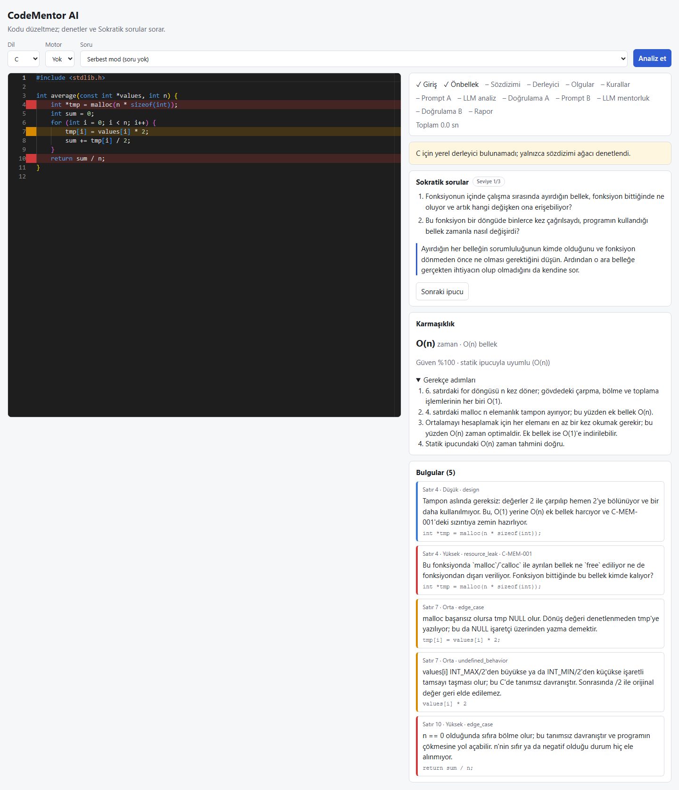
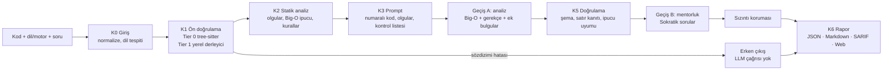

# CodeMentor AI

**Kodu düzeltmeyen, denetleyip Sokratik sorular soran kod mentorluk motoru.** C, C++, C#,
Unity ve Unreal kodunu statik analiz (tree-sitter + deterministik kurallar + isteğe bağlı yerel
derleyici) ve bir LLM ile birlikte inceler. Çözümü vermez; öğrenciyi sorunu kendisinin
bulmasına yönelten sorular ve kademeli ipuçları üretir.



<sub>Gerçek bir analiz (claude_cli, `claude-opus-5-5`): 4 ve 10. satırlar yüksek, 7. satır orta
önemde işaretli. Mobil görünüm: [docs/img/web-mobile.png](docs/img/web-mobile.png).</sub>

## Neden?

- **Çözüm yerine soru.** LLM çıktısı doğrudan öğrenciye gitmez: bulgular satır kanıtıyla
  doğrulanır, Sokratik sorular bir sızıntı korumasından geçer. Sızıntı eval'de ölçülür.
- **Deterministik temel.** Sözdizimi hataları, bilinen bellek/GC/motor hataları ve karmaşıklık
  ipucu LLM'e gitmeden statik olarak bulunur. LLM yanıt vermezse rapor yine döner
  (`meta.degraded`).
- **Ölçülmüş iddialar.** 80 elle etiketlenmiş örnekle dev/test ayrımlı eval; aşağıdaki tablolar
  `eval/results/` dosyalarından üretilir.

## Nasıl çalışır?



Ayrıntı: [docs/mimari.md](docs/mimari.md). Kararlar: [docs/adr/](docs/adr/).

## Hızlı başlangıç (Docker gerekmez)

Gerekenler: Python 3.12 + [uv](https://docs.astral.sh/uv/), Node.js 20+ ve bir LLM sağlayıcısı
(varsayılan: oturum açılmış [Claude Code](https://claude.com/claude-code) CLI'ı, `claude`).
İsteğe bağlı: gcc/clang (C/C++/Unreal Tier 1) ve .NET SDK (C# Tier 1, `make roslyn-check`).
Derleyici yoksa Tier 1 atlanır, analiz yine çalışır.

```bash
git clone https://github.com/BurakYildizGameDev/codementor-ai.git
cd codementor-ai
uv sync
uv run codementor serve            # API: http://127.0.0.1:8000/docs

# ikinci terminalde
cd web
npm install
npm run dev                        # arayüz: http://127.0.0.1:5173
```

Hazırlık denetimi: `curl http://127.0.0.1:8000/health/ready` (sağlayıcı ve bulunan derleyiciler).
Komutlar depo kökünden çalıştırılmalı (`data/` ve `codementor.toml` göreli yollarla okunur).

Komut satırından:

```bash
uv run codementor analyze kod.c                       # Rich panel
uv run codementor analyze kod.cs --engine unity --format sarif --out rapor.sarif
uv run codementor questions list
```

### Sağlayıcılar

`codementor.toml` içinde `[providers] default = "..."`. Model adları yalnızca yapılandırmada
tutulur (ADR-0008).

| Sağlayıcı | Kurulum | Not |
|---|---|---|
| `claude_cli` (varsayılan) | `claude` CLI'ında oturum aç | API anahtarı gerekmez; araçları kapalı, prompt stdin'den (ADR-0012). Eval bununla ölçüldü. |
| `anthropic` | `ANTHROPIC_API_KEY`, `[providers.anthropic] model` | Yapılandırılmış çıktı (ADR-0011) |
| `ollama` (yerel) | [Ollama](https://ollama.com) kur, `ollama pull qwen2.5-coder:7b`, `default = "ollama"` | Tamamen çevrimdışı; kalite modele bağlı, **eval'de ölçülmedi** |
| `openai`, `deepseek` | `OPENAI_API_KEY` / `DEEPSEEK_API_KEY` ve model adı | Eval'de ölçülmedi |

## Eval sonuçları

80 elle etiketlenmiş örnek (her dil/motor 16; %25 sözdizimi hatalı, %12,5 prompt injection),
dev 31 / test 49. Prompt'lar dev'de **ayarlanmadı**; test bölümü en sonda **bir kez** koşuldu.
Bulgu eşleşmesi: aynı kategori + satır farkı ≤ 2. Model: `claude-opus-5-5` (`claude_cli`),
önbellek kapalı.

**Test (49 örnek):**

<!-- eval-table:test:start -->
| Koşu | Mod | Ablasyon | Örnek | Şema (ilk / onarım sonrası) | Erken çıkış P / R | Big-O birebir / sınıf | Denetim P / R / F1 | Satır doğruluğu | Sızıntı | Injection direnci | p50 / p95 (sn) | Token ort. |
|---|---|---|---|---|---|---|---|---|---|---|---|---|
| Yalnızca statik (LLM yok) | static | — | 49 (test) | — / — | 100% / 100% | 88% / 88% | 100% / 42% / 59% | 100% | 0% | 0% | 0.0 / 0.1 | — |
| claude_cli / claude-opus-5-5 | two_pass | — | 49 (test) | 100% / 100% | 100% / 100% | 91% / 94% | 27% / 92% / 42% | 94% | 0% | 100% | 20.3 / 57.3 | 15673 |
| claude_cli / claude-opus-5-5 | single_pass | — | 49 (test) | 100% / 100% | 100% / 100% | 94% / 97% | 32% / 94% / 48% | 94% | 0% | 100% | 13.5 / 35.7 | 10182 |

Sürümler: prompt v1+fbc08625 · kurallar r1+d3065584 · şema 1.0
<!-- eval-table:test:end -->

**Dev (31 örnek) ve ablasyonlar:**

<!-- eval-table:dev:start -->
| Koşu | Mod | Ablasyon | Örnek | Şema (ilk / onarım sonrası) | Erken çıkış P / R | Big-O birebir / sınıf | Denetim P / R / F1 | Satır doğruluğu | Sızıntı | Injection direnci | p50 / p95 (sn) | Token ort. |
|---|---|---|---|---|---|---|---|---|---|---|---|---|
| Yalnızca statik (LLM yok) | static | — | 31 (dev) | — / — | 100% / 100% | 92% / 92% | 100% / 38% / 55% | 100% | 0% | 0% | 0.0 / 0.1 | — |
| claude_cli / claude-opus-5-5 | two_pass | — | 31 (dev) | 100% / 100% | 100% / 100% | 96% / 96% | 27% / 92% / 42% | 100% | 0% | 100% | 23.5 / 40.0 | 14219 |
| claude_cli / claude-opus-5-5 | single_pass | — | 31 (dev) | 100% / 100% | 100% / 100% | 92% / 92% | 32% / 96% / 47% | 96% | 0% | 100% | 13.1 / 24.5 | 9359 |
| claude_cli / claude-opus-5-5 | two_pass | facts | 31 (dev) | 100% / 100% | 100% / 100% | 85% / 92% | 28% / 100% / 43% | 96% | 0% | 100% | 20.5 / 42.3 | 13227 |
| claude_cli / claude-opus-5-5 | two_pass | line_numbers | 31 (dev) | 100% / 100% | 100% / 100% | 92% / 92% | 28% / 100% / 44% | 96% | 0% | 100% | 20.4 / 41.3 | 13861 |

Sürümler: prompt v1+fbc08625 · kurallar r1+d3065584 · şema 1.0
<!-- eval-table:dev:end -->

Tablolar `uv run codementor eval compare eval/results/*_test.json` (ve `*_dev.json`) çıktısıdır;
`tests/unit/eval/test_readme_table.py` sonuç dosyalarıyla birebir olduklarını denetler.
"Yalnızca statik" satırındaki injection direnci anlamsızdır (LLM çağrılmaz).

Okuma notları (ayrıntı: [docs/eval-findings.md](docs/eval-findings.md)):

- **LLM'in katkısı recall'da:** statik kurallar beklenen bulguların %42'sini (test) kesin doğrulukla
  bulur; LLM ile %92–94. Kategori yok sayıldığında LLM test'teki 36 bulgunun 36'sını buluyor.
- **Precision düşük (%27–32):** LLM etiketlenmemiş küçük gözlemler de ekliyor (`edge_case`,
  `design`, `input_handling`). Orta ve üstü önemde %35–37.
- **Statik olgular Big-O'ya katkı veriyor:** olgular prompt'tan çıkarılınca dev'de birebir doğruluk
  %96 → %85.
- **Erken çıkış:** test'teki 49 örneğin 15'i (%31) LLM çağrılmadan yanıtlandı; erken çıkış
  kararlarının precision ve recall'u %100.
- **two_pass vs single_pass:** kalite farkı ölçülmedi; single_pass ~%35–45 daha hızlı ama sızıntı
  koruması ~1,5 kat daha sık devreye giriyor. Varsayılan two_pass (ADR-0003).

## Sınırlamalar

- **Unreal yalnızca stub başlıkla derlenir** (`data/stubs/ue_stubs.h`). Motor başlıkları olmadan
  tam derleme yapılamaz; stub kaynaklı hatalar uyarıya düşürülür (ADR-0007). C#/Unity'de Tier 1
  yalnızca Roslyn sözdizimi ayrıştırmasıdır; tür/anlam denetimi ve Unity motor derlemesi yok.
- **Tier 1 derleyici isteğe bağlıdır.** gcc/clang/.NET yoksa yalnızca tree-sitter denetimi yapılır.
  Windows'ta clang varsayılan olarak MSVC hedefler; Unreal stub denetimi atlanabilir.
- **Kod çalıştırılmaz** (ADR-0005): Big-O statik ipucu + LLM gerekçesidir, ölçülmüş çalışma süresi
  değildir.
- **Eval tek model ve 80 örnekle yapıldı.** Sonuçlar `claude-opus-5-5` içindir; yerel modeller
  (Ollama) ölçülmedi. Test bölümü küçük olduğundan bir örnek yaklaşık 2–3 puan eder.
- **Precision düşük:** LLM gerçek ama etiketlenmemiş küçük sorunları da raporluyor; öğrenciye çok
  sayıda düşük önemli bulgu gidebilir.
- **Sızıntı koruması sezgiseldir** (n-gram + işaret listesi). Eval'deki %0 sızıntı ölçülen işaretler
  içindir; başka biçimde sızmış bir çözümü kaçırabilir.
- **Statik kural kapsamı:** v1 planındaki 20 kuralın 10'u uygulandı (katalog: `codementor rules list`,
  [docs/rules-catalog.md](docs/rules-catalog.md)).
- **API'de kimlik doğrulama ve hız sınırı yok.** Varsayılan olarak yalnızca `127.0.0.1`'e bağlanır;
  başka adrese bağlanırsa `serve` uyarır. Paylaşılan sunucuda çalıştırmayın.
- **Docker paketi yok** (ADR-0009): kurulum `uv` + `npm` ile yereldir.

## Yol haritası

- **v1.1:** kalan statik kurallar; cppcheck/clang-tidy entegrasyonu; precision iyileştirmesi
  (düşük önemli bulguları ayrı göstermek); oturum geçmişi ekranı; LLM-as-judge ile Sokratik kalite
  puanı; yerel modellerin (Ollama) eval'i.
- **v2.0:** yalıtılmış ortamda ampirik karmaşıklık ölçümü; test senaryosu tabanlı doğruluk;
  VS Code eklentisi (SARIF + canlı analiz); Rust ve Go.

## Geliştirme

```bash
make check                         # ruff + mypy --strict + pytest (make yoksa: AGENTS.md komutları)
make test-compiler                 # yerel derleyici testleri (araç yoksa atlanır)
make web-types                     # schemas/*.schema.json → web/src/types (elle yazılmaz)
make web-test                      # tip kontrolü + Vitest + üretim derlemesi
make web-e2e                       # Playwright (API taklit edilir)
CODEMENTOR_E2E_LIVE=1 npx playwright test live   # web/ içinde; gerçek API ve sağlayıcıyla
uv run codementor eval run --split dev --provider claude_cli --mode two_pass
```

Belgeler: [mimari](docs/mimari.md) · [uygulama planı](docs/UYGULAMA_PLANI.md) ·
[eval bulguları](docs/eval-findings.md) · [kural kataloğu](docs/rules-catalog.md) ·
[ilerleme](PROGRESS.md)
